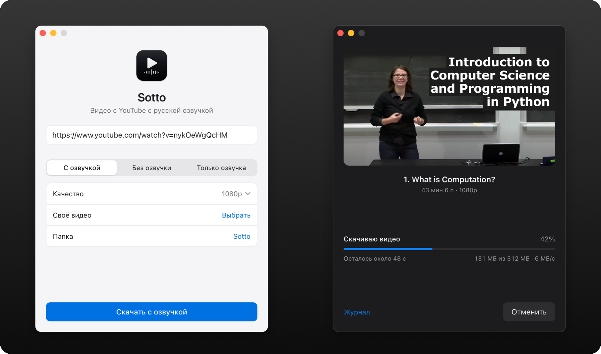
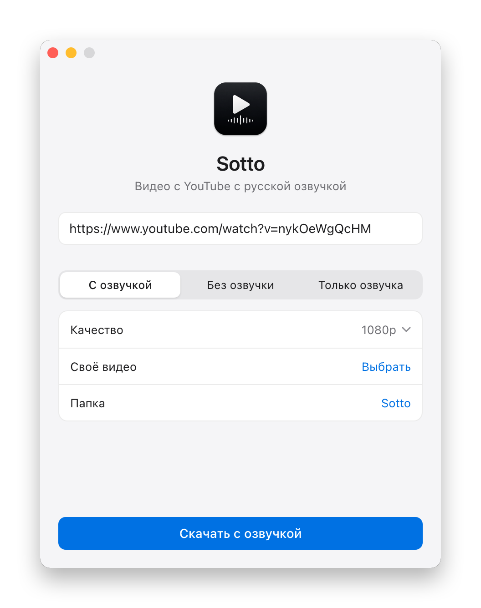
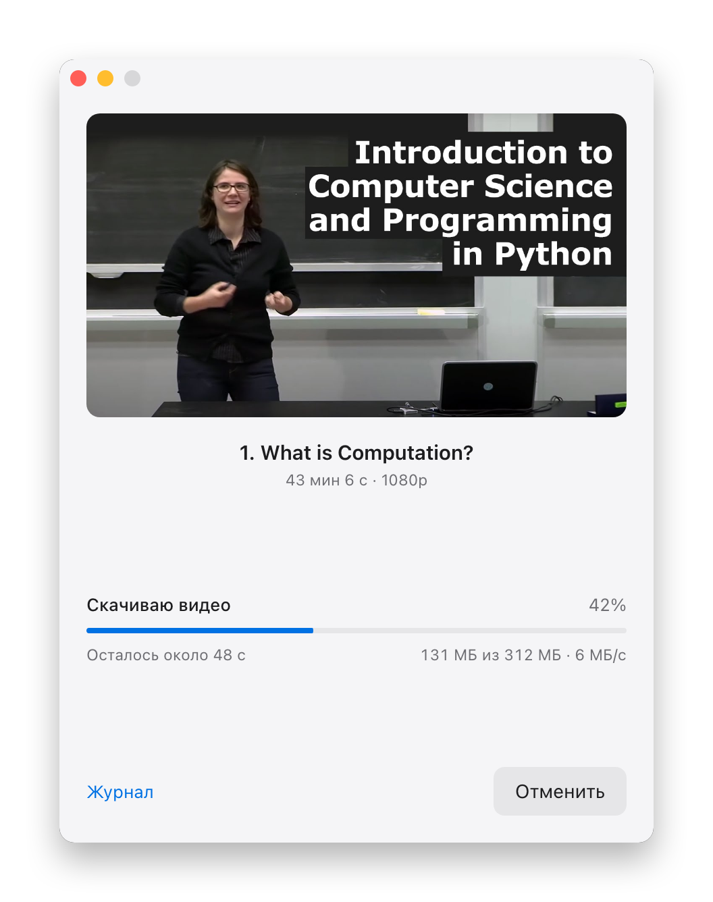
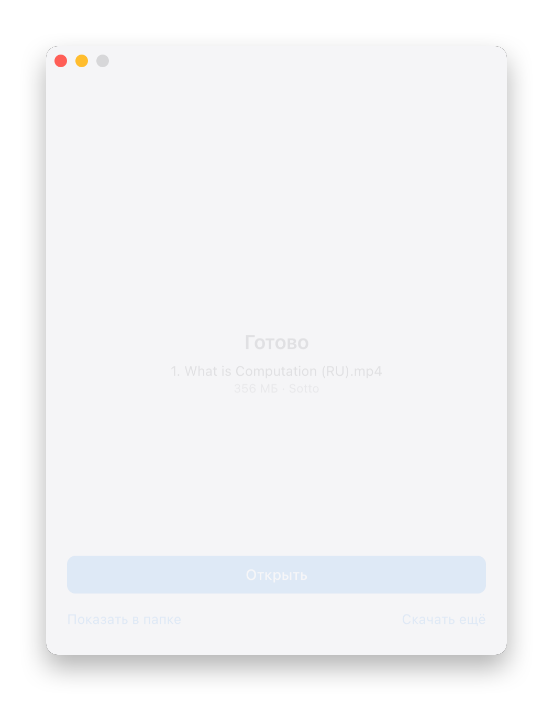
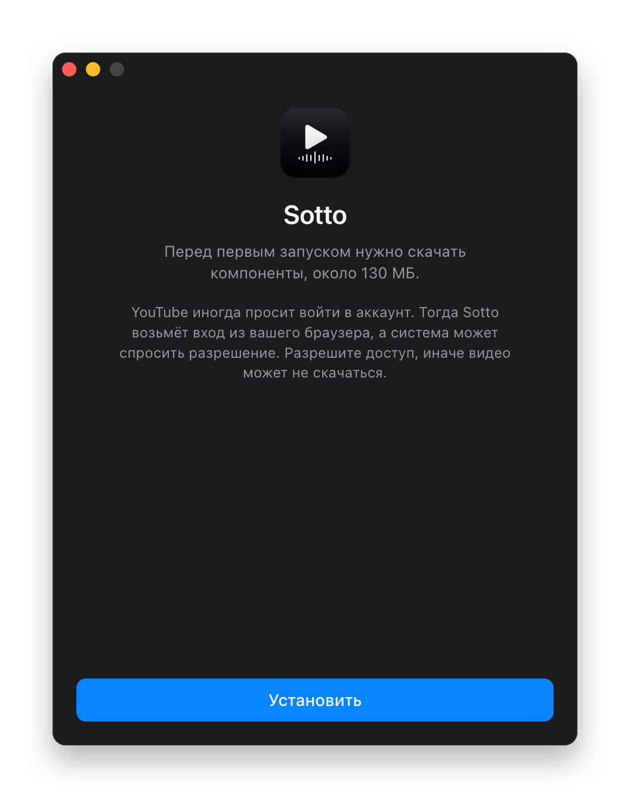
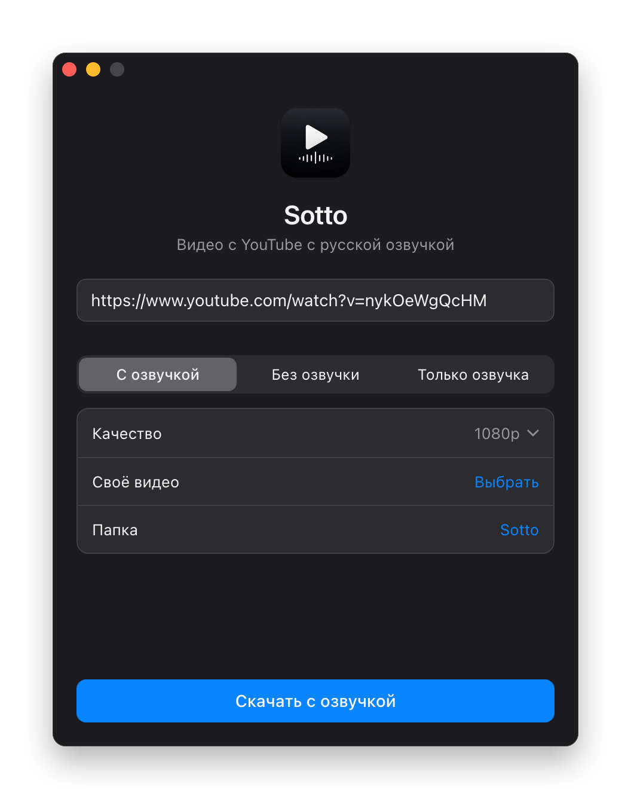
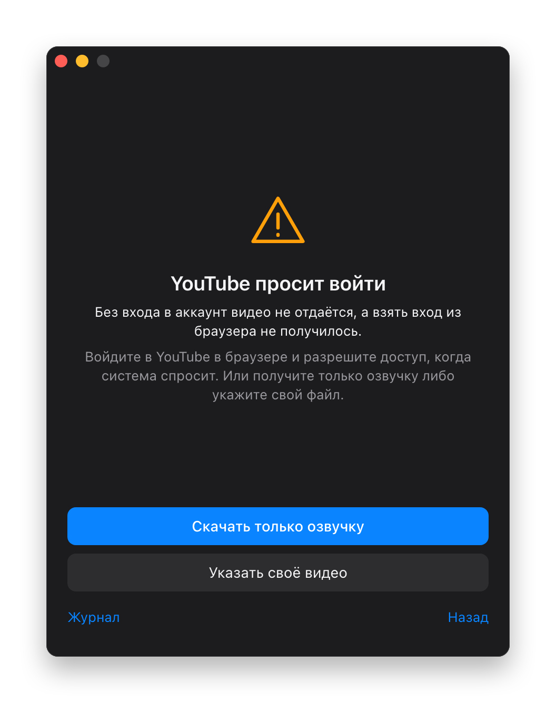

<p align="center">
  
</p>

<h1 align="center">Sotto</h1>

<p align="center">
  <b>Download YouTube videos with a Russian voice-over and watch them anywhere, even offline.</b><br>
  A free app for macOS, Windows and Linux.
</p>

<p align="center">
  <a href="https://github.com/wall-low/sotto/releases/latest"><b>Download Sotto</b></a>
  &nbsp;·&nbsp;
  <a href="README.md">Русский</a>
</p>

<p align="center">
  
</p>

Great lectures and courses on YouTube are often available only in English. Browser translation
works only while you are online with the tab open. Sotto turns the video into a regular file with
a Russian voice-over instead. The Russian voice plays on top, with the original quietly underneath.

The file is yours to keep. Watch it on a plane, on your TV, or copy it to your phone.

The app's interface is in Russian, since that is who it is for.

## How to use it

1. Copy a YouTube link.
2. Paste it into Sotto and press the download button.
3. Open the finished file.

There is nothing to configure. In our test, a two-hour lecture that Yandex had already translated was ready in 5 minutes.

## Why Sotto

- **Free, no ads.** No sign-up, subscription or limits. The code is open.
- **A regular mp4.** It opens in any player.
- **Runs on your computer.** There is no Sotto server collecting your links or files.
- **You always see what is happening.** Current step, percent, time left and speed.
- **Clear errors.** If something goes wrong, the app explains it and offers a way forward.
- **Nothing else to install.** Sotto downloads what it needs on first launch and keeps it updated.

## What you can download

| Mode | Result | Good for |
|---|---|---|
| **С озвучкой** (dubbed) | video with the Russian voice | lectures, courses, podcasts, reviews |
| **Без озвучки** (original) | a plain video with the original sound, 360p to 4K | simply saving a video |
| **Только озвучка** (voice only) | mp3 with the Russian voice | listening like an audiobook |
| **Своё видео** (your own file) | your file with the voice-over added | you already have the video |

<table>
  <tr>
    <td></td>
    <td></td>
    <td></td>
  </tr>
  <tr>
    <td></td>
    <td></td>
    <td></td>
  </tr>
</table>

## Install

Get the file for your system from the [releases page](https://github.com/wall-low/sotto/releases/latest).

| System | Which file |
|---|---|
| macOS on Apple Silicon | `.dmg` with `aarch64` in the name |
| macOS on Intel | `.dmg` with `x64` in the name |
| Windows | `-setup.exe` |
| Linux | `.AppImage` or `.deb` |

The system may warn you the first time, because the app is not signed with a paid certificate:

- **macOS:** try to open Sotto, then go to System Settings, Privacy & Security, and press Open Anyway.
- **Windows:** press More info, then Run anyway.

Sotto then downloads its components, about 130 MB. This happens only once.

## FAQ

**Is it really free?**
Yes. Sotto is MIT licensed.

**Which languages does it translate?**
From English. The Russian voice comes from Yandex.

**How good is the voice-over?**
It is automatic translation with a synthetic voice, not studio work. That is enough for lectures and reviews, less so for films.

**How long does it take?**
If someone has already translated the video, the voice arrives almost at once. A new video takes Yandex a few more minutes.

**Do I need a YouTube account?**
Usually not. Through a VPN, YouTube often asks you to prove you are not a bot. Sotto then tries to use the sign-in from a browser on your computer, and the system may ask for permission. On macOS choose Always Allow, otherwise the video may not download. The sign-in data is used only during the download and goes only to YouTube.

**What if YouTube is blocked for me?**
Downloading a video needs access to YouTube, so you may need a VPN. Voice-only mode often works without one, because the voice comes from Yandex. With your own file, you can add the voice-over to a video you got any other way.

**Can I download a whole playlist?**
Not yet, Sotto handles one video at a time.

**Can everything be dubbed?**
No. Yandex may refuse very long videos, videos without speech, or speech other than English. Sotto then offers to download the video without a voice-over.

**Why will my maximum-quality file not open?**
4K on YouTube often uses vp9 or av1, which QuickTime cannot play. Use [IINA](https://iina.io) or [VLC](https://www.videolan.org).

**Is it allowed?**
Sotto is made for personal offline viewing. Downloading may break YouTube's terms, and the voice-over uses an unofficial API. The app is not affiliated with YouTube or Yandex. Please respect copyright.

## For developers

The window is HTML, CSS and JavaScript, the core is Rust on [Tauri](https://tauri.app), so the app is about 7 MB on macOS.

The core runs [yt-dlp](https://github.com/yt-dlp/yt-dlp), [vot-cli](https://github.com/FOSWLY/vot-cli), [ffmpeg](https://ffmpeg.org) and [deno](https://deno.com) and parses their output. Components are downloaded on first launch with checksum verification, and yt-dlp updates weekly. The workflow is in [`job.rs`](src-tauri/src/job.rs).

To build from source you need Rust and Node.js:

```bash
npm ci
```

```bash
npx tauri build
```

On Linux you also need the packages from [`check.yml`](.github/workflows/check.yml). GitHub Actions builds installers for every system on a `v*` tag.

Lecture in the screenshots: [MIT 6.0001](https://ocw.mit.edu/courses/6-0001-introduction-to-computer-science-and-programming-in-python-fall-2016/), Ana Bell, MIT OpenCourseWare, CC BY-NC-SA.

[MIT](LICENSE) licensed.
