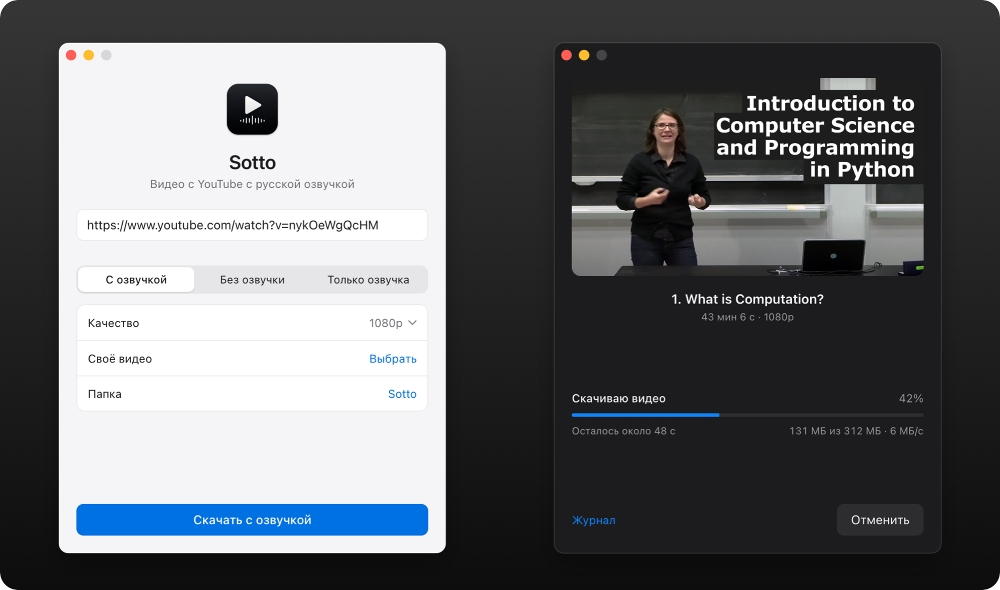
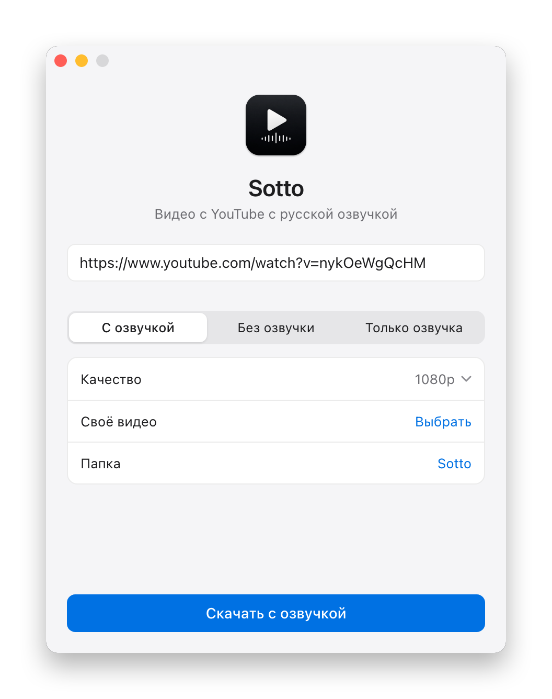
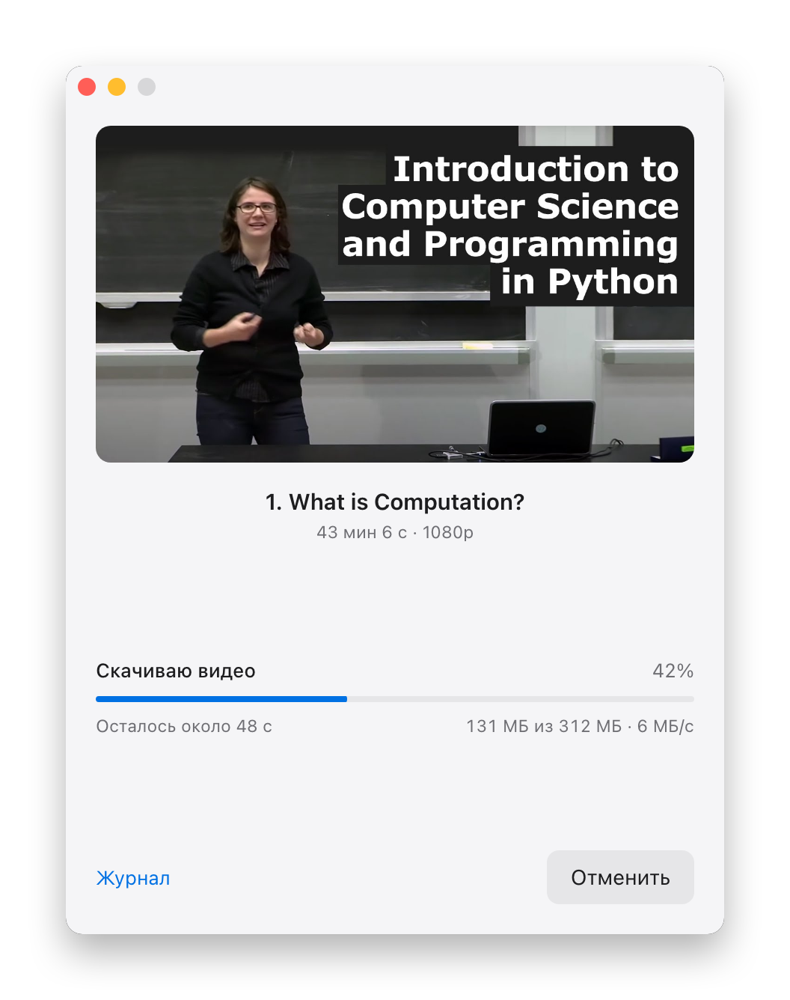
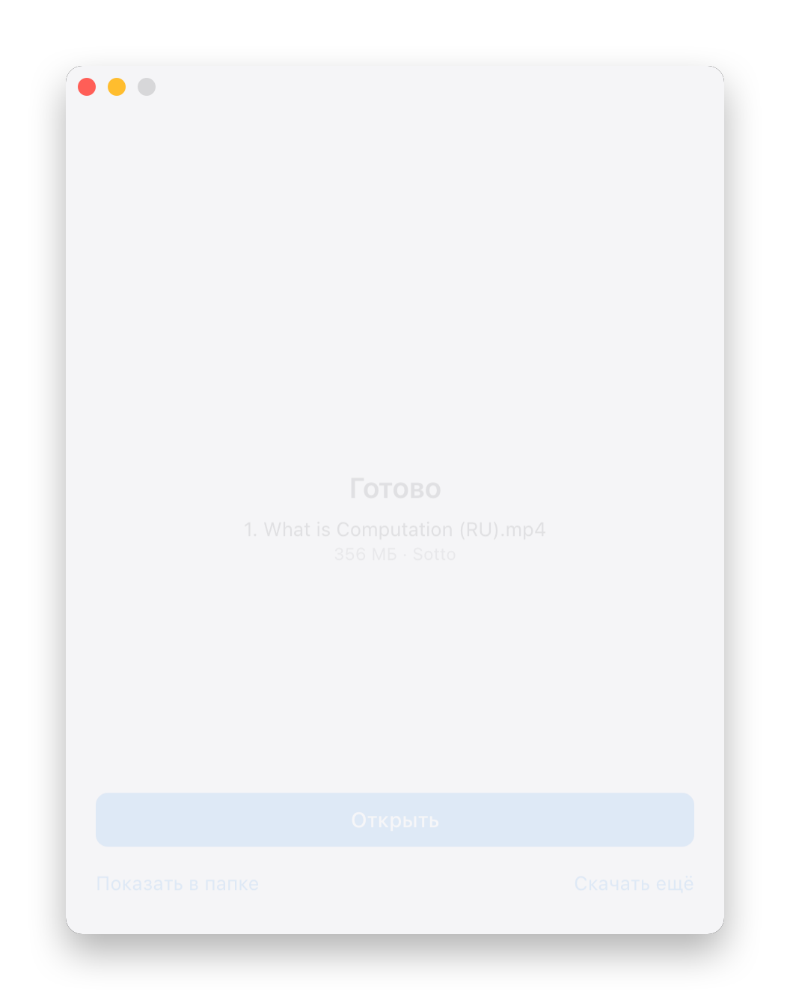
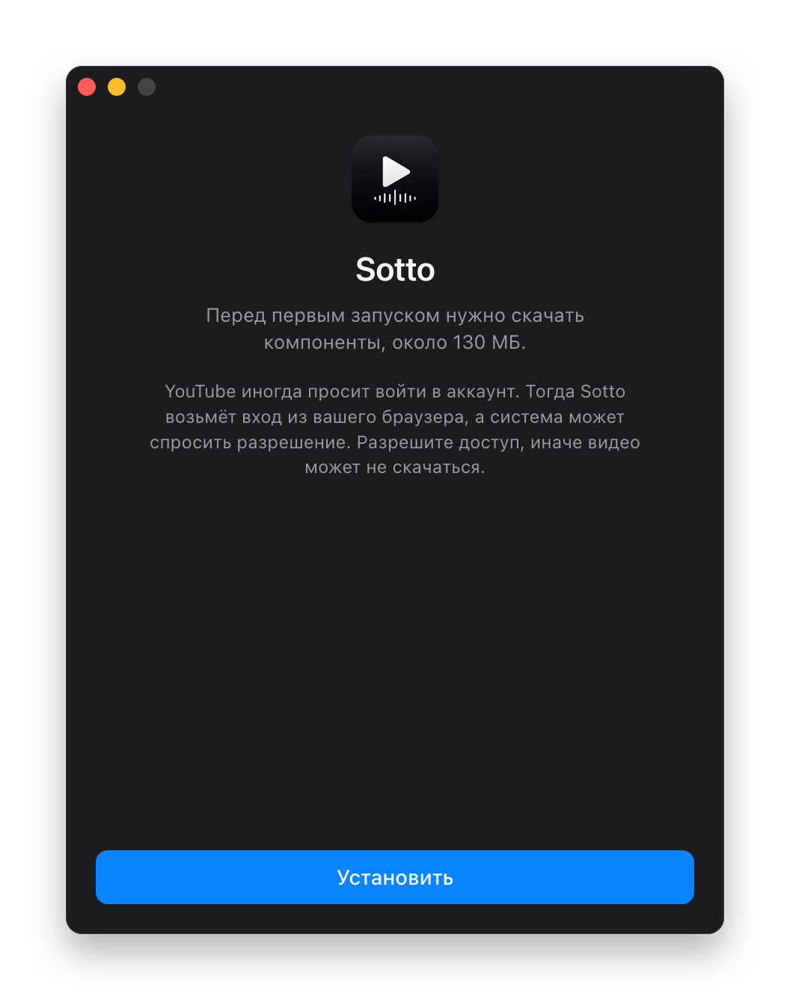
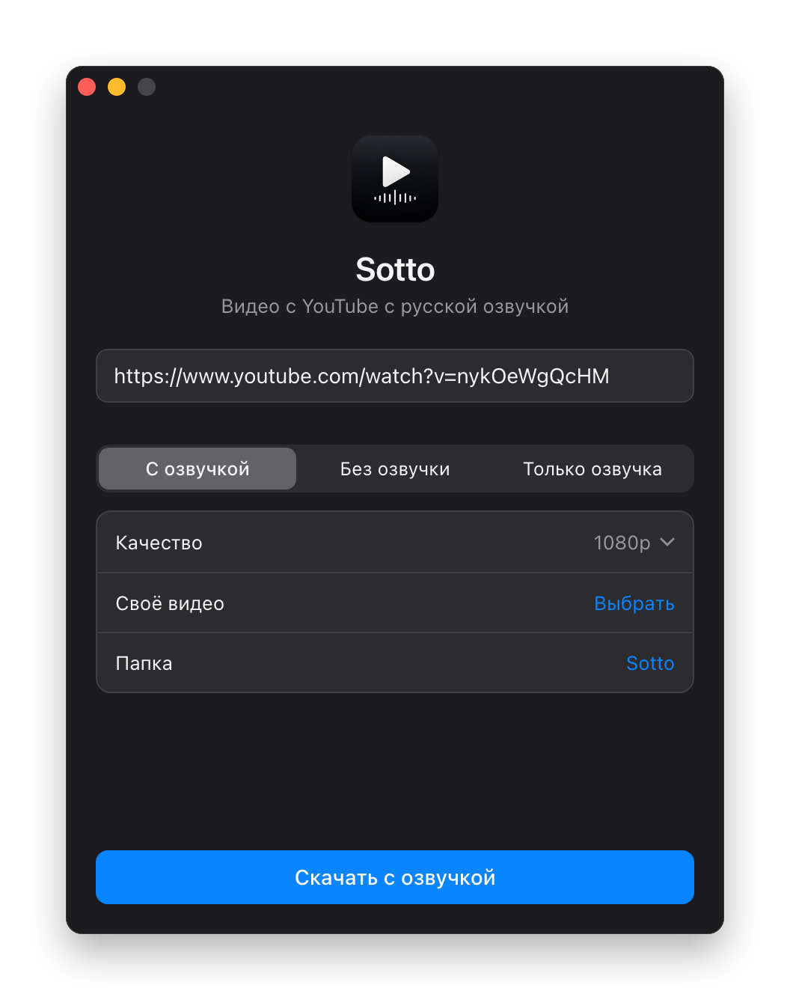
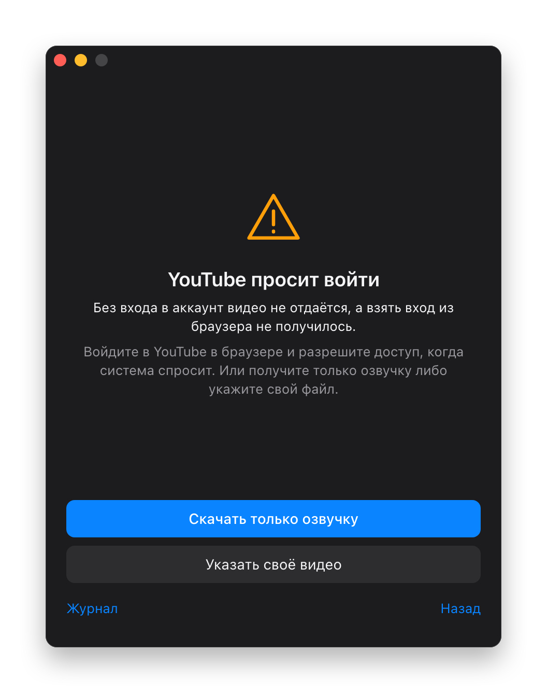

<p align="center">
  
</p>

<h1 align="center">Sotto</h1>

<p align="center">
  Save YouTube videos for offline viewing, with a Russian voice-over on top of the original.<br>
  macOS, Windows and Linux.
</p>

<p align="center">
  <a href="https://github.com/wall-low/sotto/releases/latest"><b>Download</b></a>
  &nbsp;·&nbsp;
  <a href="README.ru.md">Русский</a>
</p>

<p align="center">
  
</p>

Paste a link and press one button. Sotto fetches the video, gets the Russian voice-over from
Yandex and mixes it in, keeping the original quietly underneath at 20% volume. The name comes
from *sotto voce*, "in a low voice". The interface is in Russian, since that is who it is for.

## What it does

| Mode | Result |
|---|---|
| **С озвучкой** (dubbed) | mp4 with the Russian voice over the original sound |
| **Без озвучки** (original) | a plain download in the quality you pick, 360p up to 4K |
| **Только озвучка** (voice only) | mp3 with just the Russian voice. Usually works even when YouTube itself is blocked |
| **Своё видео** (your own file) | takes the voice from the link and adds it to a video you already have |

- Nothing to install by hand. On first launch Sotto downloads what it needs, about 130 MB, and checks every checksum.
- Stays working. yt-dlp updates itself once a week, because YouTube breaks old versions quickly.
- Shows what is going on: current step, percent, time left, speed and size.
- Explains failures in plain words and offers a way forward instead of printing a traceback.
- Follows the system light or dark theme.

<table>
  <tr>
    <td></td>
    <td></td>
    <td></td>
  </tr>
  <tr>
    <td></td>
    <td></td>
    <td></td>
  </tr>
</table>

## Install

Grab the installer for your system from [Releases](https://github.com/wall-low/sotto/releases/latest).

| System | File |
|---|---|
| macOS | `.dmg`, Apple Silicon or Intel |
| Windows | `.msi` or `-setup.exe` |
| Linux | `.AppImage` or `.deb` |

The builds are not signed with a paid certificate, so the system warns you the first time:

- **macOS:** try to open the app, then go to System Settings, Privacy & Security, and press Open Anyway.
- **Windows:** in the SmartScreen window press More info, then Run anyway.

## YouTube sign-in

On a regular home connection you usually do not need one. Through a VPN, YouTube often asks to
prove you are not a bot. Sotto then tries the browsers on your computer one by one, reads the
YouTube session with yt-dlp and remembers which browser worked. The cookies are used only while
the download runs and go only to YouTube.

The system may ask for permission. On macOS that is keychain access, choose Always Allow. Without
it the video may not download.

On Windows, Chrome encrypts cookies in a way yt-dlp often cannot read, so Firefox is the safer choice there.

## How it works

The window is plain HTML, CSS and JavaScript. The core is Rust on [Tauri](https://tauri.app), so the
app stays small, about 7 MB on macOS. The core runs these tools and reads their output:

| Tool | Job |
|---|---|
| [yt-dlp](https://github.com/yt-dlp/yt-dlp) | downloads the video |
| [vot-cli](https://github.com/FOSWLY/vot-cli) | gets the Yandex voice-over |
| [ffmpeg](https://ffmpeg.org) | mixes the audio, the video stream is copied untouched |
| [deno](https://deno.com) | yt-dlp needs it for YouTube's checks |

The order in [`job.rs`](src-tauri/src/job.rs) matters:

1. Check the link. If YouTube wants a sign-in, walk through the browsers.
2. Get the voice first, so a refusal from Yandex does not waste a full video download.
3. Download the video, preferring h264 so QuickTime can open it.
4. Mix: the original at 20% with the voice on top.

`vot-cli` does not report its progress, so Sotto watches the mp3 grow instead. The bitrate is
constant, which means the final size is known in advance.

## Build from source

You need Rust and Node.js. On Linux, also the packages listed in
[`check.yml`](.github/workflows/check.yml).

```bash
npm ci
```

```bash
npx tauri build
```

Run the core without a window:

```bash
cd src-tauri && cargo test --lib
```

```bash
cargo run --example cli -- run dubbed 720 ./out 'https://www.youtube.com/watch?v=...'
```

GitHub Actions builds installers for every system when a `v*` tag is pushed.

## Limits

- Yandex does not voice everything: very long videos and speech other than English can be refused.
- For a video nobody has translated yet, Yandex does not report the time left.
- The maximum quality can be vp9 or av1. QuickTime will not open those, use IINA or VLC.

## Disclaimer

A personal tool for watching videos offline, not affiliated with YouTube or Yandex. Downloading
may break YouTube's terms, and the voice-over goes through an unofficial API. Respect copyright
and the terms of these services.

The icon was generated with AI. The screenshots show the interface with sample progress values
and lecture 1 of [MIT 6.0001](https://ocw.mit.edu/courses/6-0001-introduction-to-computer-science-and-programming-in-python-fall-2016/)
by Ana Bell, MIT OpenCourseWare, CC BY-NC-SA.

## License

[MIT](LICENSE)
