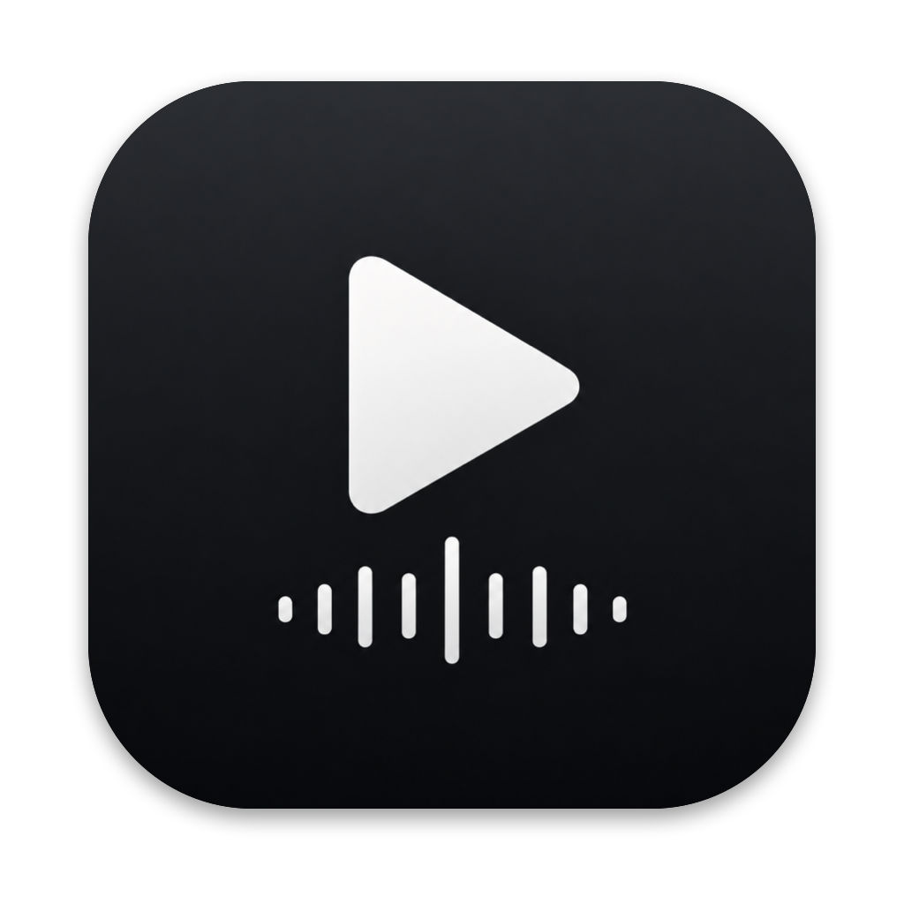
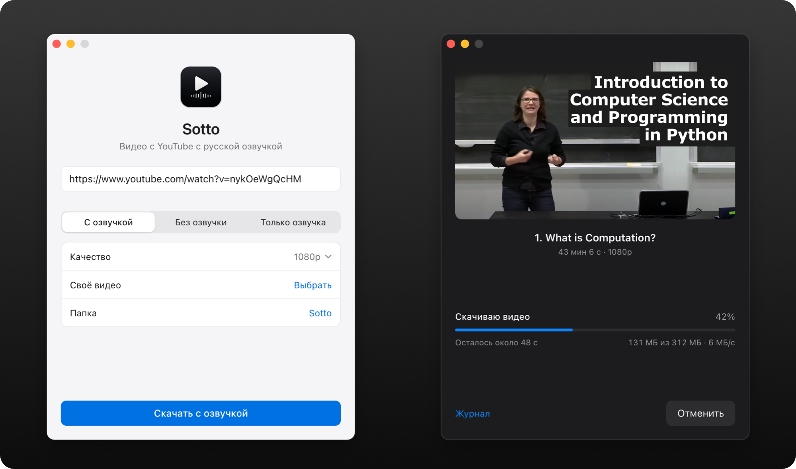
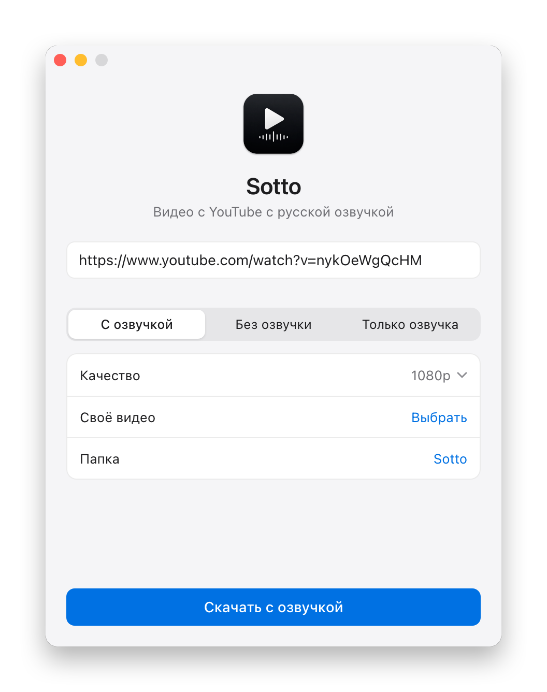
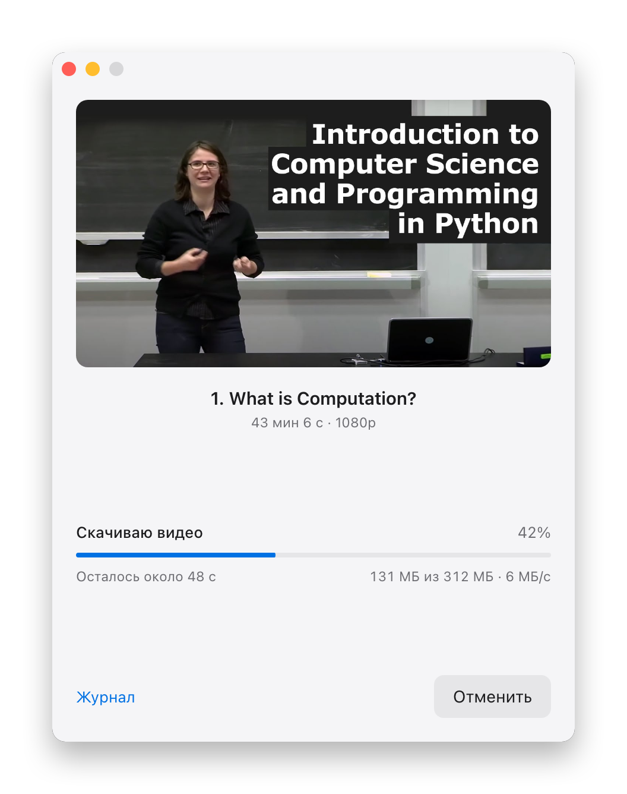
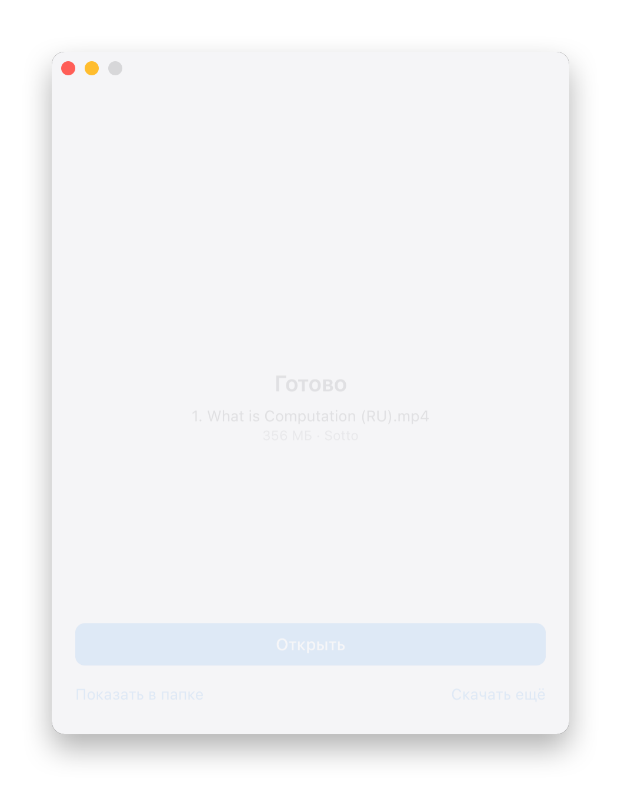
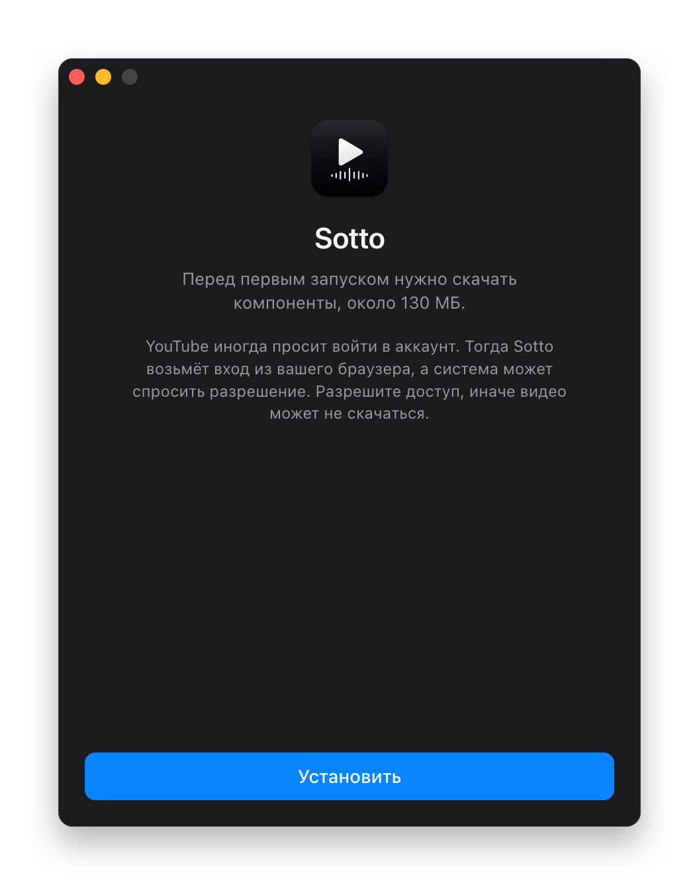
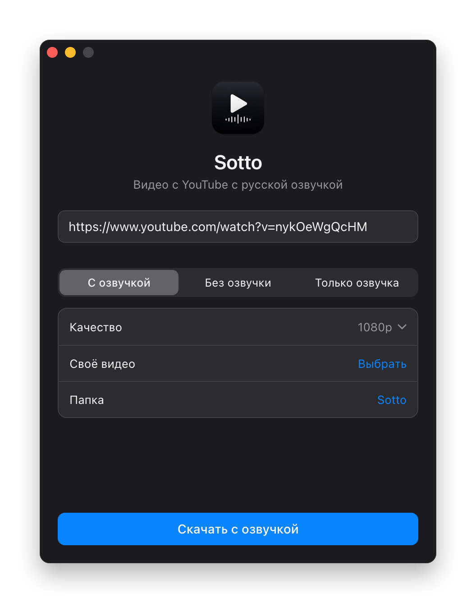
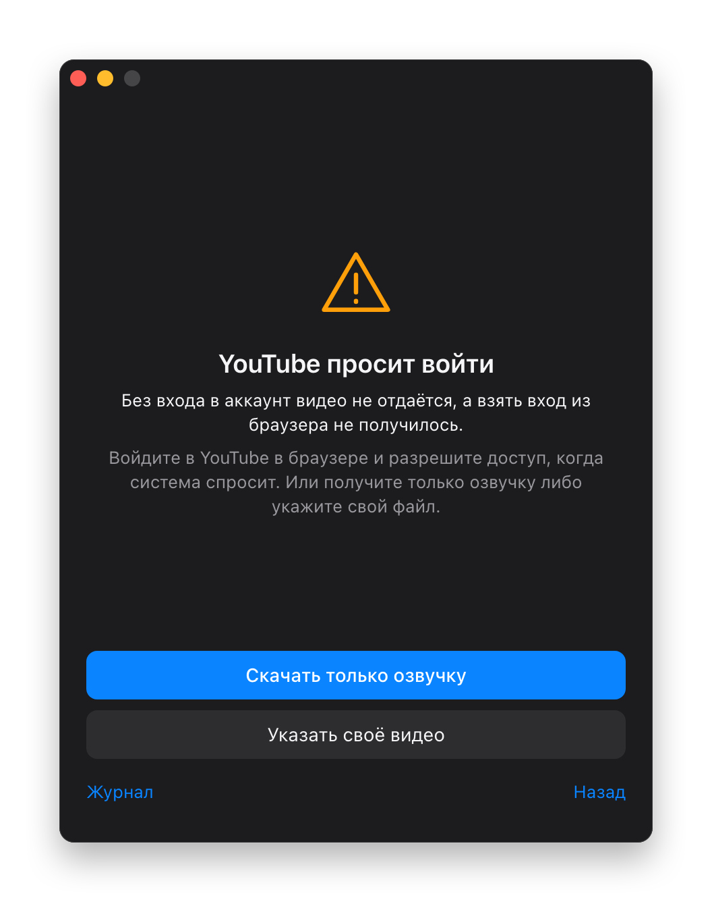

<p align="center">
  
</p>

<h1 align="center">Sotto</h1>

<p align="center">
  Скачивает видео с YouTube для просмотра офлайн и накладывает русскую озвучку поверх оригинала.<br>
  macOS, Windows и Linux.
</p>

<p align="center">
  <a href="https://github.com/wall-low/sotto/releases/latest"><b>Скачать</b></a>
  &nbsp;·&nbsp;
  <a href="README.md">English</a>
</p>

<p align="center">
  
</p>

Вставляете ссылку и нажимаете одну кнопку. Sotto скачивает видео, получает русскую озвучку
от Яндекса и смешивает звук: голос поверх, а оригинал тихо звучит под ним на 20% громкости.
Отсюда название: *sotto voce* значит «вполголоса».

## Что умеет

| Режим | Что получится |
|---|---|
| **С озвучкой** | mp4 с русским голосом поверх оригинала |
| **Без озвучки** | обычное скачивание в нужном качестве, от 360p до 4K |
| **Только озвучка** | mp3 с русским голосом. Обычно работает, даже если YouTube закрыт |
| **Своё видео** | голос берётся по ссылке и добавляется к видео, которое у вас уже есть |

- Ничего не надо ставить вручную. При первом запуске Sotto скачает нужные компоненты, около 130 МБ, и сверит контрольные суммы.
- Не устаревает. yt-dlp обновляется сам раз в неделю, потому что YouTube быстро ломает старые версии.
- Показывает, что происходит: этап, проценты, оставшееся время, скорость и размер.
- Объясняет ошибки человеческим языком и предлагает, что делать дальше.
- Подстраивается под светлую и тёмную тему системы.

<table>
  <tr>
    <td></td>
    <td></td>
    <td></td>
  </tr>
  <tr>
    <td></td>
    <td></td>
    <td></td>
  </tr>
</table>

## Установка

Скачайте установщик для своей системы в [Releases](https://github.com/wall-low/sotto/releases/latest).

| Система | Файл |
|---|---|
| macOS | `.dmg`, для Apple Silicon или Intel |
| Windows | `.msi` или `-setup.exe` |
| Linux | `.AppImage` или `.deb` |

Сборки не подписаны платным сертификатом, поэтому при первом запуске система предупредит:

- **macOS:** попробуйте открыть приложение, затем зайдите в Системные настройки, Конфиденциальность и безопасность, и нажмите «Всё равно открыть».
- **Windows:** в окне SmartScreen нажмите «Подробнее», затем «Выполнить в любом случае».

## Вход в YouTube

На обычном домашнем интернете вход чаще всего не нужен. Через VPN YouTube часто просит подтвердить,
что вы не бот. Тогда Sotto по очереди пробует браузеры на компьютере, читает сессию YouTube
с помощью yt-dlp и запоминает, какой браузер подошёл. Cookies используются только во время
загрузки и передаются только самому YouTube.

Система может спросить разрешение. На macOS это доступ к связке ключей, выберите «Всегда разрешить».
Без этого видео может не скачаться.

На Windows Chrome шифрует cookies так, что yt-dlp часто не может их прочитать, там надёжнее Firefox.

## Как устроено

Окно написано на обычных HTML, CSS и JavaScript. Ядро на Rust и [Tauri](https://tauri.app),
поэтому приложение маленькое, на macOS около 7 МБ. Ядро запускает эти программы и разбирает их вывод:

| Программа | Зачем |
|---|---|
| [yt-dlp](https://github.com/yt-dlp/yt-dlp) | скачивание видео |
| [vot-cli](https://github.com/FOSWLY/vot-cli) | озвучка Яндекса |
| [ffmpeg](https://ffmpeg.org) | смешивание звука, видео не перекодируется |
| [deno](https://deno.com) | нужен yt-dlp для проверок YouTube |

Порядок работы в [`job.rs`](src-tauri/src/job.rs) не случаен:

1. Проверка ссылки. Если YouTube просит вход, Sotto перебирает браузеры.
2. Сначала озвучка, чтобы при отказе Яндекса не качать видео зря.
3. Скачивание видео, по возможности в h264, чтобы файл открывался в QuickTime.
4. Смешивание: оригинал на 20% и голос поверх.

`vot-cli` не сообщает о ходе работы, поэтому Sotto следит за растущим mp3. Битрейт у него
постоянный, значит итоговый размер известен заранее.

## Сборка из исходников

Нужны Rust и Node.js, на Linux ещё пакеты из [`check.yml`](.github/workflows/check.yml).

```bash
npm ci
```

```bash
npx tauri build
```

Запуск ядра без окна:

```bash
cd src-tauri && cargo test --lib
```

```bash
cargo run --example cli -- run dubbed 720 ./out 'https://www.youtube.com/watch?v=...'
```

Установщики для всех систем собирает GitHub Actions по тегу `v*`.

## Ограничения

- Яндекс озвучивает не всё: бывает отказ на очень длинных видео и на речи не на английском.
- Для видео, которое ещё никто не переводил, Яндекс не сообщает оставшееся время.
- Максимальное качество может оказаться в vp9 или av1. QuickTime такое не откроет, нужен IINA или VLC.

## Важно

Личный инструмент для просмотра видео офлайн, не связан с YouTube и Яндексом. Скачивание может
нарушать условия YouTube, озвучка идёт через неофициальный API. Соблюдайте авторские права
и условия сервисов.

Иконка сгенерирована нейросетью. На скриншотах интерфейс с примерными значениями прогресса
и первая лекция курса [MIT 6.0001](https://ocw.mit.edu/courses/6-0001-introduction-to-computer-science-and-programming-in-python-fall-2016/),
Ana Bell, MIT OpenCourseWare, CC BY-NC-SA.

## Лицензия

[MIT](LICENSE)
